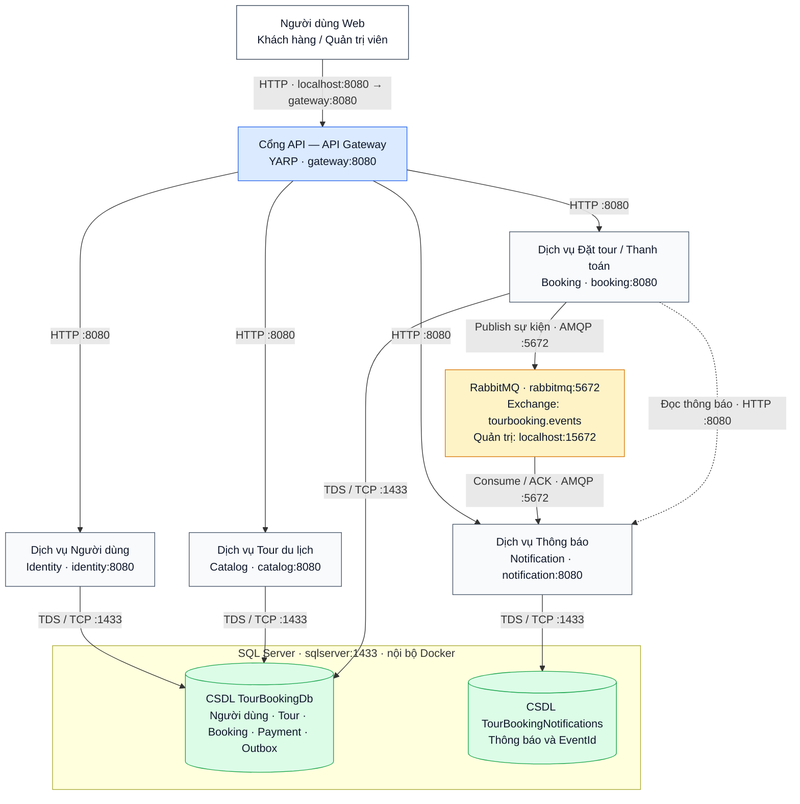

# Tourbooking — Ứng dụng đặt tour phân tán

## Sơ đồ kiến trúc hệ thống



Sơ đồ được viết trực tiếp bằng **Mermaid trong README**, có thể sửa các khối và đường nối ngay trong Markdown. GitHub hiển thị sơ đồ khi mở README. Trong VS Code, dùng bản xem trước hỗ trợ Mermaid; tab chỉnh sửa sẽ hiện mã sơ đồ.

Tourbooking là ứng dụng đặt tour du lịch gồm **5 dịch vụ chạy trong các tiến trình riêng**, giao tiếp qua **HTTP và RabbitMQ**. Người dùng truy cập một website qua Gateway; các dịch vụ phía sau xử lý tài khoản, danh mục tour, booking/thanh toán và thông báo.

Toàn bộ môi trường chạy bằng Docker Compose: **5 container ứng dụng + SQL Server + RabbitMQ**. Dự án minh họa phân chia xử lý, giao tiếp bất đồng bộ, định danh, đồng bộ dữ liệu, sao lưu và phục hồi khi có lỗi.

> **Phạm vi kiến trúc:** Identity, Catalog và Booking hiện dùng chung database nghiệp vụ và thư viện MVC/EF. Notification có database riêng. Các dịch vụ chạy độc lập ở mức tiến trình nhưng vẫn phụ thuộc schema và mã dùng chung. Môi trường demo chạy trên một máy; tách database theo miền nghiệp vụ và triển khai cụm nhiều máy là hướng phát triển tiếp theo.

## Mục lục

- [Chức năng](#chức-năng)
- [Kiến trúc phân tán](#kiến-trúc-phân-tán)
- [Chạy nhanh bằng Docker](#chạy-nhanh-bằng-docker)
- [Sử dụng website](#sử-dụng-website)
- [RabbitMQ và thông báo](#rabbitmq-và-thông-báo)
- [SQL và lưu trữ dữ liệu](#sql-và-lưu-trữ-dữ-liệu)
- [Vận hành và kiểm thử](#vận-hành-và-kiểm-thử)
- [Sao lưu và khôi phục](#sao-lưu-và-khôi-phục)
- [Mã nguồn và API](#mã-nguồn-và-api)
- [Tài liệu đồ án](#tài-liệu-đồ-án)

## Chức năng

| Đối tượng | Chức năng |
| --- | --- |
| Khách truy cập | Xem, tìm kiếm tour; đăng ký tài khoản; gửi yêu cầu tư vấn |
| Khách hàng đăng nhập | Đặt tour, xem thông tin chuyển khoản, báo đã thanh toán, theo dõi/hủy/đổi lịch booking, đánh giá và xem thông báo |
| Quản trị viên | Quản lý tour, người dùng, booking; xác nhận thanh toán; trả lời tư vấn và xem dashboard |

**Thanh toán hiện tại:** khách chuyển khoản và gửi yêu cầu xác nhận. Booking/thanh toán chuyển sang `Processing`; khi Admin xác nhận, booking chuyển sang `Confirmed` và thanh toán sang `Paid`. Dự án chưa tích hợp cổng thu tiền tự động.

## Kiến trúc phân tán

Sơ đồ thể hiện cấu hình Docker đang sử dụng: người dùng đi vào Gateway, Gateway chuyển request đến bốn dịch vụ; Booking phát sự kiện qua RabbitMQ để Notification xử lý. Ba dịch vụ nghiệp vụ dùng chung `TourBookingDb`; database thông báo nằm trên cùng SQL Server nhưng tách riêng dữ liệu. Booking cũng gọi Notification qua HTTP `notification:8080` khi hiển thị trang thông báo.

### Cổng và đường đi của kết nối

**Cổng trên máy** dùng với `localhost`. **Cổng nội bộ Docker** dùng với tên dịch vụ, chỉ các container trong mạng truy cập được nếu chưa publish ra máy. Nhiều dịch vụ cùng dùng cổng `8080` vì mỗi dịch vụ ở một container riêng.

| Nguồn → Đích | Giao thức | Địa chỉ / cổng đích | Truy cập từ máy |
| --- | --- | --- | --- |
| Trình duyệt → Gateway | HTTP | `localhost:8080` → `gateway:8080` | Có: http://localhost:8080 |
| Gateway → Identity | HTTP | `identity:8080` | Qua Gateway |
| Gateway → Catalog | HTTP | `catalog:8080` | Qua Gateway |
| Gateway → Booking | HTTP | `booking:8080` | Qua Gateway |
| Gateway → Notification API | HTTP | `notification:8080` | Qua Gateway |
| Booking → Notification API | HTTP | `notification:8080` | Nội bộ Docker |
| Booking / Notification ↔ RabbitMQ | AMQP | `rabbitmq:5672` | Có publish `127.0.0.1:5672` cho AMQP client; đây không phải trang web |
| Trình duyệt quản trị → RabbitMQ | HTTP | `localhost:15672` → `rabbitmq:15672` | Có: http://localhost:15672 |
| Identity / Catalog / Booking / Notification → SQL Server | TDS qua TCP | `sqlserver:1433` | Không publish cổng SQL ra máy |

**Website demo đang dùng HTTP, chưa cấu hình cổng HTTPS `443` hoặc bộ cân bằng tải riêng.** Gateway hiện chạy một instance và định tuyến request bằng YARP. Payment nằm trong Booking; hệ thống hiện chưa có dịch vụ chỗ ngồi riêng như hình tham khảo.

### Gateway chuyển URL đến dịch vụ nào?

Tất cả URL dưới đây được mở từ `http://localhost:8080`:

| URL ví dụ | Dịch vụ đích | Địa chỉ đích trong Docker |
| --- | --- | --- |
| `/Account/Login`, `/Account/Register`, `/Account/Profile`, `/Admin/Users`, `/api/identity/me` | Identity | `http://identity:8080` |
| `/`, `/Tours`, `/Tours/Details/1`, `/Admin/Tours`, `/api/tours` | Catalog | `http://catalog:8080` |
| `/Home/Booking`, `/Home/Payment`, `/Home/ConfirmPayment`, `/Account/Bookings`, `/Admin/Bookings`, `/api/bookings` | Booking | `http://booking:8080` |
| `/Home/Contact`, `/Account/Reviews`, `/Admin/Dashboard`, `/Notifications` | Booking | `http://booking:8080` |
| `/api/notifications`, `/api/notifications/admin` | Notification | `http://notification:8080` |

Trang `/Notifications` được dựng bởi Booking và gọi API của Notification qua HTTP nội bộ. Các tuyến cụ thể như `/Account/Bookings` được ưu tiên trước tuyến chung `/Account/...`.

| Dịch vụ | Trách nhiệm chính | Giao tiếp |
| --- | --- | --- |
| **Gateway** | Điểm truy cập website; định tuyến URL; kiểm tra sức khỏe dịch vụ | HTTP, YARP |
| **Identity** | Đăng ký, đăng nhập, hồ sơ, vai trò và quản lý người dùng | HTTP, SQL |
| **Catalog** | Tìm kiếm, xem, quản lý tour và hình ảnh | HTTP, SQL |
| **Booking** | Đặt/hủy/đổi lịch, thanh toán, đánh giá, tư vấn, dashboard; phát sự kiện | HTTP, SQL, RabbitMQ |
| **Notification** | Nhận sự kiện, lưu thông báo và cung cấp API đọc thông báo | RabbitMQ, HTTP, database riêng |

Các dịch vụ tìm nhau bằng DNS trong mạng Docker, ví dụ `booking`, `sqlserver`, `rabbitmq`. Trình duyệt truy cập ứng dụng qua Gateway tại cổng `8080`. Các dịch vụ nghiệp vụ và SQL Server không mở cổng trực tiếp ra máy chủ trong cấu hình hiện tại.

| Nội dung phân tán | Cơ chế đã triển khai |
| --- | --- |
| Giao tiếp giữa tiến trình | HTTP cho request, RabbitMQ cho sự kiện bất đồng bộ |
| Định danh | Docker DNS, URI, GUID cho sự kiện/yêu cầu, cookie Identity dùng chung key ring |
| Đồng bộ dữ liệu | SQL transaction, rowversion, unique RequestId và lease cho worker |
| Chống xử lý trùng | EventId là khóa duy nhất của thông báo |
| Chịu lỗi | Outbox, kết nối lại broker, publisher confirms, consumer ACK, retry và dead-letter queue |
| Theo dõi và phục hồi | Health checks, correlation ID, restart policy, backup/restore |

## Chạy nhanh bằng Docker

### Yêu cầu

- Docker Engine hoặc Docker Desktop đang chạy, sử dụng Linux containers.
- Docker Compose; có script cài binary chính thức nếu máy chưa có Compose.
- PowerShell trên Windows; nên dành ít nhất khoảng 4 GB RAM cho môi trường Docker.
- Không cần cài SQL Server hoặc .NET SDK trên máy nếu chỉ chạy bằng Docker.

### Khởi động trên Windows

Mở PowerShell tại thư mục chứa `compose.yaml`:

```powershell
# Tạo .env với mật khẩu ngẫu nhiên; giữ nguyên nếu đã tồn tại
./scripts/Initialize-Environment.ps1

# Chỉ chạy nếu máy chưa có Docker Compose
./scripts/Setup-Compose.ps1

# Build và chạy ứng dụng, SQL Server, RabbitMQ
./scripts/Compose.ps1 up -d --build

# Chờ các dịch vụ chuyển sang healthy
./scripts/Compose.ps1 ps
```

Lần đầu cần tải image và build mã nguồn nên có thể mất vài phút. `Compose.ps1` dùng binary trong `.tools` nếu có, hoặc gọi `docker compose` đã cài trên máy.

Trên Linux/macOS, tạo `.env` từ `.env.example`, điền mật khẩu riêng, rồi dùng `docker compose up -d --build` và `docker compose ps`.

### Địa chỉ và tài khoản

| Thành phần | Địa chỉ | Đăng nhập |
| --- | --- | --- |
| Website | http://localhost:8080 | Tự đăng ký tài khoản khách hàng |
| Quản trị website | Đăng nhập trên website bằng tài khoản Admin | `ADMIN_EMAIL`, `ADMIN_PASSWORD` trong `.env` |
| RabbitMQ Management | http://localhost:15672 | Username `tourbooking`, mật khẩu `RABBITMQ_PASSWORD` trong `.env` |
| Kiểm tra hệ thống | http://localhost:8080/health/ready | Không cần đăng nhập |

Không commit hoặc chia sẻ `.env`. Các cổng công khai hiện chỉ bind vào `127.0.0.1`, phù hợp demo trên máy. Triển khai công khai cần cấu hình địa chỉ truy cập, HTTPS và secrets phù hợp.

## Sử dụng website

1. Đăng ký và đăng nhập tài khoản khách hàng.
2. Chọn tour, nhập thông tin liên hệ, số khách và ngày khởi hành trong tương lai.
3. Đặt tour để đến trang hướng dẫn chuyển khoản.
4. Sau khi chuyển khoản, gửi yêu cầu xác nhận thanh toán.
5. Admin đăng nhập bằng tài khoản riêng, kiểm tra và xác nhận booking.
6. Khách hàng xem booking và mở **Thông báo** trong menu tài khoản để theo dõi cập nhật. Thông báo có thể xuất hiện sau vài giây do được xử lý bất đồng bộ.

Khi database Docker còn trống, hệ thống tự tạo schema và thêm ba tour mẫu. Chỉ Identity thực hiện migration khi khởi động Compose, tránh nhiều dịch vụ cùng khởi tạo schema.

## RabbitMQ và thông báo

### Luồng xử lý

```text
Khách đặt tour qua Gateway
    → Booking lưu booking + payment + sự kiện outbox trong một SQL transaction
    → Worker gửi sự kiện từ outbox đến RabbitMQ
    → Notification nhận sự kiện, lưu thông báo rồi ACK message
    → Khách xem thông báo trên website
```

Outbox giữ sự kiện khi RabbitMQ tạm ngừng hoạt động. Worker đánh dấu đã phát sau khi broker xác nhận tiếp nhận. Nếu sự kiện được giao lại, Notification dùng EventId để tránh lưu thông báo trùng. Đây là giao nhận ít nhất một lần với cơ chế khử trùng ở consumer.

| Thành phần | Tên | Vai trò |
| --- | --- | --- |
| Topic exchange | `tourbooking.events` | Nhận sự kiện booking, payment và contact |
| Queue chính | `tourbooking.notifications` | Chờ Notification xử lý |
| Queue thử lại | `tourbooking.notifications.retry` | Đợi 5 giây trước khi giao lại |
| Dead-letter queue | `tourbooking.notifications.dead` | Giữ message không hợp lệ hoặc lỗi sau tối đa 5 lần thử lại |

### Quan sát message

Mở RabbitMQ Management, đăng nhập rồi vào **Queues and Streams → tourbooking.notifications**:

| Chỉ số | Ý nghĩa |
| --- | --- |
| Ready | Message đang chờ được giao |
| Unacked | Message đã giao nhưng consumer chưa xác nhận |
| Consumers | Số consumer đang nhận message |

Queue bằng `0` vẫn có thể hoạt động đúng vì Notification xử lý rất nhanh. Để dễ quan sát, tạm dừng consumer:

```powershell
./scripts/Compose.ps1 stop notification
```

Tạo booking trên website rồi kiểm tra queue: **Ready** sẽ tăng. Bật lại consumer và xem log:

```powershell
./scripts/Compose.ps1 start notification
./scripts/Compose.ps1 logs -f booking notification
```

Message được xử lý và thông báo xuất hiện trên tài khoản khách hàng. Nhấn `Ctrl+C` để thoát xem log; dịch vụ vẫn chạy.

### Kiểm tra khi broker gián đoạn

```powershell
./scripts/Test-Resilience.ps1
```

Script tạo tài khoản thử, dừng RabbitMQ, tạo booking rồi bật lại broker. Kết quả mong đợi: booking vẫn được lưu khi broker dừng, sự kiện được giao sau khi kết nối lại. Script có tạm gián đoạn broker của dự án và tạo dữ liệu thử trong database Docker.

## SQL và lưu trữ dữ liệu

SQL Server chạy trong container `sqlserver` và quản lý hai database:

| Database | Nội dung | Dịch vụ sử dụng |
| --- | --- | --- |
| `TourBookingDb` | Tài khoản, tour, booking, payment, review, tư vấn và outbox | Identity, Catalog, Booking |
| `TourBookingNotifications` | Thông báo; EventId dùng để khử trùng | Notification |

Dữ liệu được giữ trong Docker named volume:

| Volume | Nội dung |
| --- | --- |
| `sql-data` | Dữ liệu SQL Server |
| `sql-backups` | File backup SQL trong container |
| `rabbit-data` | Dữ liệu broker và message được lưu bền vững |
| `auth-keys` | Khóa Data Protection để các dịch vụ đọc cùng cookie đăng nhập |
| `tour-images` | Ảnh tour của Catalog |

Tên volume thực tế có thể có tiền tố project Compose. Dừng hoặc tạo lại container vẫn giữ volume. **Không dùng `down -v` nếu cần giữ dữ liệu.**

Database Docker tách biệt với LocalDB cũ trên máy. Compose không tự chuyển dữ liệu LocalDB sang Docker; muốn sử dụng dữ liệu cũ cần chuyển dữ liệu riêng. Đẩy image lên Docker Hub cũng không mang theo dữ liệu trong volume.

## Vận hành và kiểm thử

### Các lệnh thường dùng

```powershell
# Xem trạng thái
./scripts/Compose.ps1 ps

# Xem log; Ctrl+C để thoát
./scripts/Compose.ps1 logs -f gateway booking notification

# Build và cập nhật sau khi sửa mã nguồn
./scripts/Compose.ps1 up -d --build

# Dừng toàn bộ, giữ dữ liệu
./scripts/Compose.ps1 down

# Chạy lại
./scripts/Compose.ps1 up -d
```

`/health/live` kiểm tra Gateway còn hoạt động. `/health/ready` trả `200` khi các dịch vụ phía sau sẵn sàng, hoặc `503` nếu có dịch vụ chưa sẵn sàng. Những tuyến còn khỏe vẫn có thể phục vụ. Readiness của Booking kiểm tra SQL, cho phép nhận booking khi RabbitMQ gián đoạn nhờ outbox.

Compose dùng `restart: unless-stopped` để khởi động lại tiến trình bị thoát; trạng thái `unhealthy` tự nó không làm container restart. Bản hiện tại chưa có cụm SQL/RabbitMQ nhiều node hoặc failover tự động giữa các máy.

### Integration tests

Sau khi hệ thống đã khởi động và healthy:

```powershell
./scripts/Compose.ps1 --profile test run --build --no-deps --rm tests
```

Test chạy qua Gateway và kết nối SQL/RabbitMQ thực tế, kiểm tra định tuyến, cookie dùng chung, quyền truy cập, CSRF, đặt tour/thanh toán, chống booking trùng, rollback outbox, cập nhật đồng thời và khử trùng sự kiện. Các test tạo tài khoản và booking thử trong database Docker.

Nếu đã cài .NET SDK 10, kiểm tra build mã nguồn trên máy bằng:

```powershell
dotnet build Tourbooking.sln
```

### Xử lý nhanh sự cố

| Tình huống | Cách kiểm tra |
| --- | --- |
| Không mở được website | Kiểm tra Docker, `Compose.ps1 ps` và log `gateway` |
| Container còn starting | Chờ SQL/migration; xem log `sqlserver`, `identity` nếu kéo dài |
| Báo thiếu cấu hình mật khẩu | Chạy `Initialize-Environment.ps1` và kiểm tra `.env` |
| Chưa có thông báo | Kiểm tra `notification`, `rabbitmq`, queue chính và log Booking |
| Không thấy dữ liệu LocalDB cũ | Docker dùng database riêng; dữ liệu cũ chưa được chuyển tự động |

## Sao lưu và khôi phục

```powershell
# Tạo bản sao lưu trong backups/<thời điểm>
./scripts/Backup.ps1

# Ghi đè dữ liệu hiện tại bằng bản sao lưu đã chọn
./scripts/Restore.ps1 -BackupDirectory ./backups/THU_MUC_BACKUP -Apply
```

Backup gồm hai SQL database với CHECKSUM/VERIFYONLY, RabbitMQ definitions, khóa xác thực, ảnh tour và manifest SHA256. Restore kiểm tra checksum, dừng dịch vụ ứng dụng, khôi phục dữ liệu rồi khởi động lại. Giữ `.env` riêng và bảo vệ backup vì có dữ liệu cùng khóa xác thực.

RabbitMQ definitions mô tả cấu hình broker, không chứa message đang nằm trong queue. Khi mất volume broker, có thể phát lại sự kiện từ outbox bằng `Replay-Outbox.ps1` theo [hướng dẫn phục hồi](docs/bao-cao-he-thong-phan-tan.md). Có thể lên lịch `Backup.ps1` bằng Windows Task Scheduler; dự án chưa tự đăng ký lịch sao lưu.

## Mã nguồn và API

```text
services/
├── Gateway/             # Reverse proxy và health checks
├── Identity/            # Tiến trình dịch vụ tài khoản
├── Catalog/             # Tiến trình dịch vụ tour
├── Booking/             # Tiến trình đặt tour và thanh toán
└── Notification/        # Consumer, database và API thông báo
Distributed/             # Host chung, ranh giới endpoint, outbox, RabbitMQ topology
Controllers/             # MVC controllers và API nghiệp vụ
Data/                    # DbContext và migrations
Models/                  # Các thực thể nghiệp vụ
Views/                   # Giao diện Razor MVC
tests/RabbitMq.Tests/    # Integration tests
scripts/                 # Khởi tạo, Compose, kiểm thử chịu lỗi, backup/restore
docs/                    # Báo cáo, kịch bản demo, kết quả kiểm chứng
Dockerfile               # Build image cho từng dịch vụ
compose.yaml             # Khai báo toàn bộ môi trường Docker
.env.example             # Mẫu cấu hình, không chứa mật khẩu thực
```

Các API truy cập qua Gateway. API riêng tư dùng cookie đăng nhập của website; thao tác ghi hiện thực hiện qua form MVC có antiforgery token.

| Endpoint | Quyền |
| --- | --- |
| `GET /api/tours`, `GET /api/tours/{id}` | Công khai |
| `GET /api/identity/me` | Đăng nhập |
| `GET /api/bookings`, `GET /api/bookings/{id}` | Booking của người đang đăng nhập |
| `GET /api/bookings/outbox` | Admin |
| `GET /api/notifications` | Thông báo của người đang đăng nhập |
| `GET /api/notifications/admin` | Admin |
| `GET /health/live`, `GET /health/ready` | Công khai |

Project gốc `Tourbooking.csproj` cung cấp thư viện MVC/EF chung và giữ chế độ chạy MVC với LocalDB:

```powershell
dotnet run --project Tourbooking.csproj
```

Chế độ MVC không bật RabbitMQ mặc định. Để chạy và đánh giá kiến trúc phân tán, dùng Docker Compose. Khi phát triển schema, tạo migration bằng `dotnet ef migrations add TenMigration --project Tourbooking.csproj` với công cụ EF phù hợp đã cài.

## Tài liệu đồ án

- [Báo cáo theo 8 chương và sơ đồ kiến trúc](docs/bao-cao-he-thong-phan-tan.md)
- [Kịch bản thuyết trình và demo](docs/kich-ban-demo.md)
- [Kết quả kiểm chứng thực tế](docs/ket-qua-kiem-thu.md)
