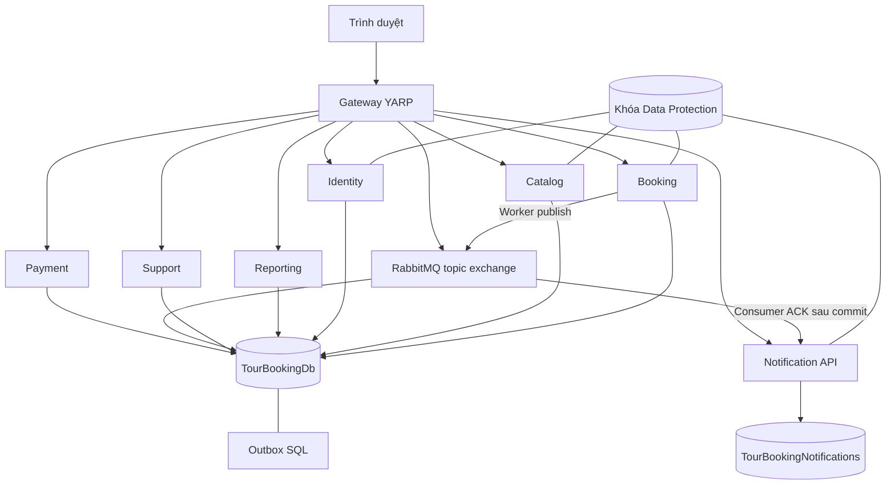
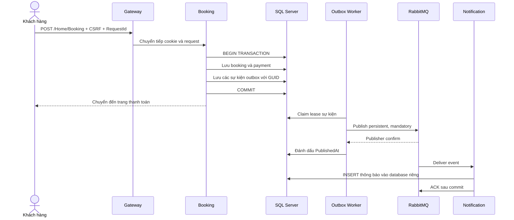

# Thiết kế hệ thống đặt tour phân tán

Hệ thống phục vụ tìm kiếm tour, đăng ký tài khoản, đặt tour, chuyển khoản có xác nhận thủ công và theo dõi thông báo. Mục tiêu đồ án là tách trách nhiệm xử lý thành các tiến trình độc lập, trao đổi thông tin qua HTTP và RabbitMQ, đồng thời minh họa đồng bộ dữ liệu, phục hồi lỗi và sao lưu. Phạm vi triển khai là môi trường Docker trên một máy; các container là các node logic, chưa phải một cụm nhiều máy có tính sẵn sàng cao.

## Chương 1 Mở đầu

Ứng dụng ban đầu là ASP.NET Core MVC dùng SQL Server LocalDB. Toàn bộ chức năng chạy trong một tiến trình nên việc dừng ứng dụng ảnh hưởng tất cả chức năng. Bản phân tán giữ trải nghiệm hiện có và chia các nhóm chức năng sang những dịch vụ có thể khởi động, dừng và quan sát riêng. Thông báo được xử lý bất đồng bộ để lỗi broker hoặc dịch vụ thông báo không làm mất yêu cầu đặt tour.

Yêu cầu chức năng gồm quản lý người dùng và vai trò; quản lý tour; đặt, hủy, đổi lịch; xác nhận chuyển khoản; đánh giá tour; trao đổi tư vấn; thông báo cá nhân và quản trị. Yêu cầu phi chức năng gồm chống cập nhật đè, bảo vệ dữ liệu theo chủ sở hữu, chống thao tác giả mạo, ghi nhận sự kiện đáng tin cậy, kiểm tra sức khỏe và phục hồi dữ liệu.

## Chương 2 Kiến trúc

Gateway định tuyến theo controller/action để giữ URL cũ. Identity xử lý xác thực và quản lý người dùng. Catalog sở hữu các endpoint quản lý tour. Booking xử lý đặt/hủy/đổi lịch. Payment xử lý yêu cầu thanh toán. Review xử lý đánh giá và bình chọn. Support xử lý tư vấn và phản hồi. Reporting xử lý dashboard và xuất Excel. Notification nhận sự kiện và lưu vào database riêng. Mỗi dịch vụ có project khởi động và container riêng, biên dịch controller và giao diện riêng; thư viện persistence và hạ tầng chung nằm trong Shared/.

Các dịch vụ nghiệp vụ dùng chung database trong giai đoạn này. Ràng buộc khóa ngoại và giao dịch đặt tour/thanh toán được giữ lại. Thiết kế này đáp ứng mô hình dịch vụ phân tán nhưng còn phụ thuộc schema và phiên bản thư viện dùng chung. Muốn chuyển thành microservices độc lập dữ liệu, cần tách Catalog, Identity và Booking databases, thay navigation xuyên domain bằng DTO/REST hoặc projection sự kiện, rồi di chuyển các màn hình báo cáo tổng hợp. Bản hiện tại không tuyên bố đã hoàn thành bước đó.

## Chương 3 Tiến trình và luồng

Mỗi container ứng dụng là một tiến trình ASP.NET Core. Request HTTP chạy bất đồng bộ qua `async/await`; truy vấn SQL và I/O RabbitMQ không chặn luồng xử lý trong khi đợi mạng. OutboxDispatcher là BackgroundService, mỗi lượt lấy tối đa 20 sự kiện và xử lý tuần tự trên một channel. NotificationConsumer dùng AsyncEventingBasicConsumer với prefetch 10 để giới hạn message chưa được ACK.

Nếu worker chết sau khi publish nhưng trước khi ghi PublishedAt, sự kiện được phát lại khi lease hết hạn. Consumer khử trùng bằng EventId. Đây là giao nhận ít nhất một lần với hiệu ứng lưu thông báo không trùng, không phải cam kết exactly-once trên toàn hệ thống.

## Chương 4 Trao đổi thông tin

HTTP được dùng giữa trình duyệt, Gateway và dịch vụ đích. API đọc gồm `/api/tours`, `/api/identity/me`, `/api/bookings` và `/api/notifications`. Form MVC là các endpoint ghi, có antiforgery token. Màn hình thông báo gọi Notification API qua HTTP nội bộ và chuyển cookie của chính người dùng để áp dụng phân quyền.

RabbitMQ dùng topic exchange `tourbooking.events` và các event `booking.created`, `booking.updated`, `payment.created`, `payment.updated`, `contact.created`, `contact.updated`. Envelope gồm EventId, Type, Source, ResourceId, UserId, Email, Status, OccurredAt và CorrelationId. Không đưa mật khẩu hoặc cookie vào message. Sự kiện hiện là thông tin trạng thái, chưa phải nhật ký event sourcing đầy đủ.

Queue chính, retry và dead-letter đều durable; publisher đặt persistent. Publisher confirms cho biết broker đã tiếp nhận publish. Consumer ACK chỉ sau khi database commit. Hai xác nhận này phục vụ hai giai đoạn riêng của luồng giao nhận. Chi tiết giao thức: [RabbitMQ confirms](https://www.rabbitmq.com/docs/confirms) và [reliability](https://www.rabbitmq.com/docs/reliability).

## Chương 5 Định danh

Docker DNS định vị dịch vụ bằng tên `identity`, `catalog`, `booking`, `payment`, `review`, `support`, `reporting`, `notification`, `sqlserver`, `rabbitmq`. Các tên có thể giữ ổn định khi IP container thay đổi. URI định danh tài nguyên HTTP. BookingId và PaymentId do SQL identity cấp, tránh cách tìm số ID trống vốn gây xung đột khi nhiều tiến trình cùng tạo.

EventId và RequestId là GUID. RequestId đặt trong form, có unique index trong SQL và được kiểm tra theo người dùng để gửi lại cùng yêu cầu không tạo booking thứ hai. EventId được giữ nguyên khi retry/publish lại. CorrelationId xuất phát từ trace HTTP, được đưa vào event và log consumer; response nghiệp vụ có header X-Correlation-ID và X-Service-Name.

Xác thực dùng ASP.NET Core Identity cookie. Các dịch vụ dùng chung application name, cookie name, scheme và key ring Data Protection. Không cần JWT để minh họa định danh trong kiến trúc hiện tại. Form chống CSRF; API và thông báo chỉ trả dữ liệu thuộc người đang đăng nhập. Admin được kiểm tra bằng role. Cấu hình cookie dùng chung theo [hướng dẫn Microsoft](https://learn.microsoft.com/aspnet/core/security/cookie-sharing).

## Chương 6 Đồng bộ hóa

Booking và Payment có SQL rowversion. EF Core đưa phiên bản cũ vào điều kiện UPDATE; nếu request khác đã cập nhật, thao tác sau bị từ chối và HTTP trả 409, yêu cầu tải lại dữ liệu. Unique RequestId chống duplicate booking kể cả khi hai request cùng vượt qua bước kiểm tra ban đầu.

Outbox cùng dữ liệu nghiệp vụ nằm trong một SQL transaction. Worker lấy lease bằng `UPDLOCK`, `READPAST`, `ROWLOCK` và transaction để hai replica không cùng claim một hàng đang được giữ. Lease kéo dài hai phút và có thể phục hồi sau khi tiến trình chết. Một publish chậm quá lease vẫn có thể gây phát trùng; khóa EventId tại consumer xử lý trường hợp này.

Notification dùng khóa chính EventId như inbox đồng thời cũng là bản ghi thông báo. Kiểm tra trước khi INSERT giúp giảm xung đột; unique key là cơ chế quyết định khi nhiều consumer nhận trùng đồng thời. Không dùng Redis distributed lock vì các thao tác đang cần đồng bộ đều có thể giải quyết bằng transaction, lease và ràng buộc SQL.

## Chương 7 Sao lưu

`scripts/Backup.ps1` tạo full backup cho TourBookingDb và TourBookingNotifications, dùng CHECKSUM và RESTORE VERIFYONLY; xuất broker definitions, khóa cookie và ảnh tour; ghi manifest SHA256. SQL, RabbitMQ, khóa và ảnh có named volume để tồn tại khi container được tạo lại. Một máy/volume bị mất vẫn có thể làm mất dữ liệu nếu bản sao lưu chỉ nằm trên cùng thiết bị, vì vậy cần sao chép thư mục backup ra thiết bị hoặc storage riêng.

`scripts/Restore.ps1` kiểm tra checksum trước khi thao tác, dừng các dịch vụ ứng dụng, khôi phục hai database và các file, rồi khởi động lại ứng dụng. Tham số `-Apply` là dấu hiệu rõ ràng đây là thao tác ghi đè. Có thể lên lịch Backup.ps1 bằng Windows Task Scheduler; dự án cung cấp script, chưa tự đăng ký lịch trên máy người dùng.

Broker definitions không chứa nội dung queue. Khi mất `rabbit-data`, có thể phát lại các sự kiện đã có trong outbox bằng `scripts/Replay-Outbox.ps1 -SinceUtc ...`; ID sự kiện giữ nguyên để consumer loại bản trùng. Phải chọn thời điểm trước sự cố và kiểm tra dead-letter queue. Dữ liệu tạo sau mốc backup có thể không khôi phục được: RPO phụ thuộc lịch backup, RTO phụ thuộc kích thước dữ liệu và thời gian khởi động. VERIFYONLY xác minh cấu trúc backup, không thay thế một lần diễn tập restore đầy đủ.

## Chương 8 Chịu lỗi

| Sự cố | Cách hệ thống phản ứng | Bằng chứng cần quan sát |
| --- | --- | --- |
| RabbitMQ dừng | Booking vẫn commit SQL/outbox; worker kết nối lại mỗi 5 giây | Booking tồn tại, outbox pending tăng |
| Notification dừng | Queue giữ message chưa xử lý | Queue messages tăng, sau start thông báo xuất hiện |
| Consumer chết trước ACK | Broker giao lại message | EventId không tạo thông báo thứ hai |
| Message không hợp lệ | NACK không requeue, đưa vào DLQ | Message xuất hiện ở notifications.dead |
| Lưu thông báo lỗi tạm thời | Confirm bản retry trước ACK bản gốc, đợi TTL 5 giây | Tối đa 5 retry rồi DLQ |
| Worker chết khi giữ lease | Lease hết hạn sau 2 phút, worker khác có thể nhận | Outbox tiếp tục được phát |
| Hai request cập nhật cùng booking | Rowversion phát hiện bản cũ | HTTP 409, không ghi đè âm thầm |
| SQL Server lỗi | Readiness 503 và request ghi thất bại | Không báo đặt tour thành công khi SQL chưa lưu |

Gateway dùng active health checks YARP và chỉ định tuyến đến destination khỏe. Các route hoạt động độc lập; dependency thông báo lỗi không buộc Catalog hoặc Booking ngừng phục vụ. Compose cấu hình restart unless-stopped để phục hồi tiến trình bị thoát, nhưng không tự restart chỉ vì healthcheck unhealthy. Chưa có replica SQL, cluster RabbitMQ, cân bằng nhiều destination hay circuit breaker đầy đủ; đây là các hướng mở rộng, không phải tính năng đã có.

Hướng dẫn cấu hình proxy: [Microsoft YARP](https://learn.microsoft.com/aspnet/core/fundamentals/servers/yarp/config-files).

## Kiểm chứng và đối chiếu tiêu chí

`tests/RabbitMq.Tests` gồm smoke test publish/receive RabbitMQ, workflow HTTP qua Gateway và kiểm tra dữ liệu SQL. Kết quả chạy thực tế cần xem log `dotnet test`; không suy ra điểm số từ việc tồn tại công nghệ. Các test tạo dữ liệu thử, nên chạy trên database demo trước khi dùng dữ liệu thật.

| Tiêu chí | Thành phần minh họa |
| --- | --- |
| Mở đầu | Mục tiêu, phạm vi và yêu cầu chương 1 |
| Kiến trúc | 9 project dịch vụ, Compose, sơ đồ chương 2 |
| Tiến trình và luồng | ASP.NET async, BackgroundService, consumer |
| Trao đổi thông tin | HTTP endpoints và RabbitMQ |
| Định danh | Docker DNS, URI, GUID, Identity cookie |
| Đồng bộ hóa | SQL transaction, rowversion, unique index, lease, inbox |
| Sao lưu | Backup/Restore scripts, CHECKSUM, SHA256, volumes |
| Chịu lỗi | Outbox reconnect, retry/DLQ, readiness, restart |
| Thuyết trình | Kịch bản demo kèm trong docs |
